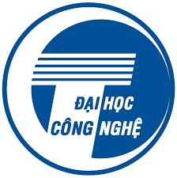
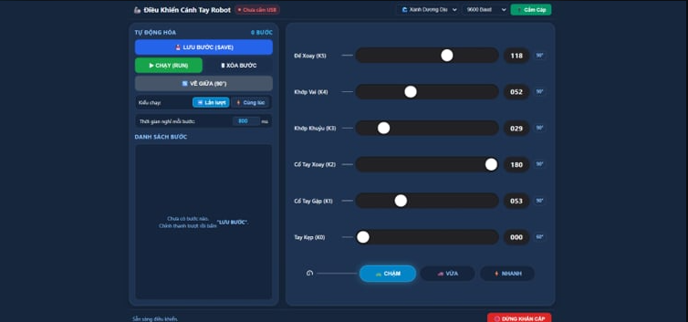
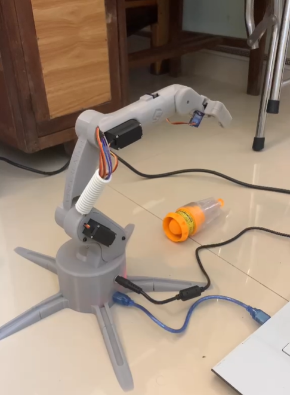
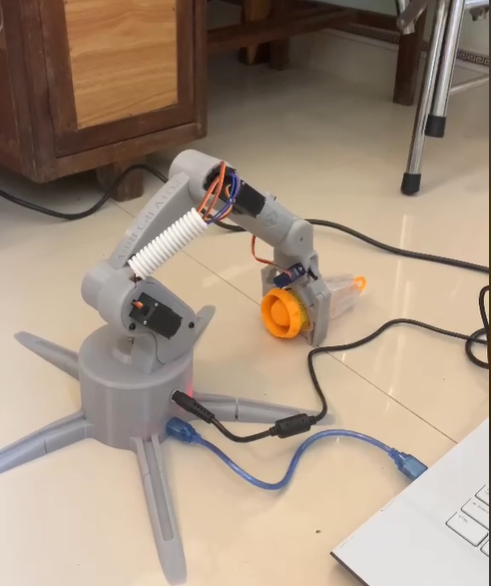
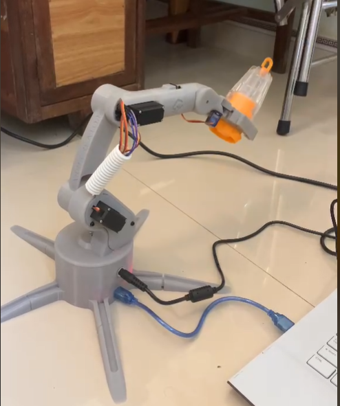
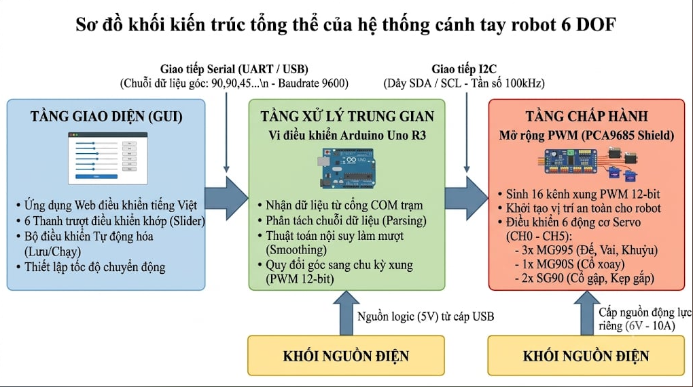
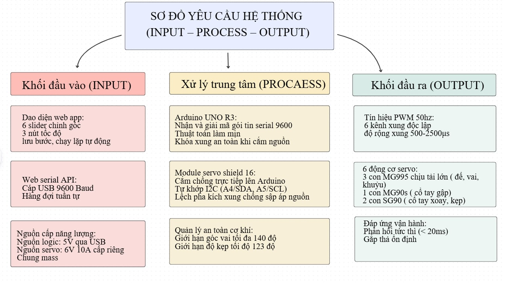
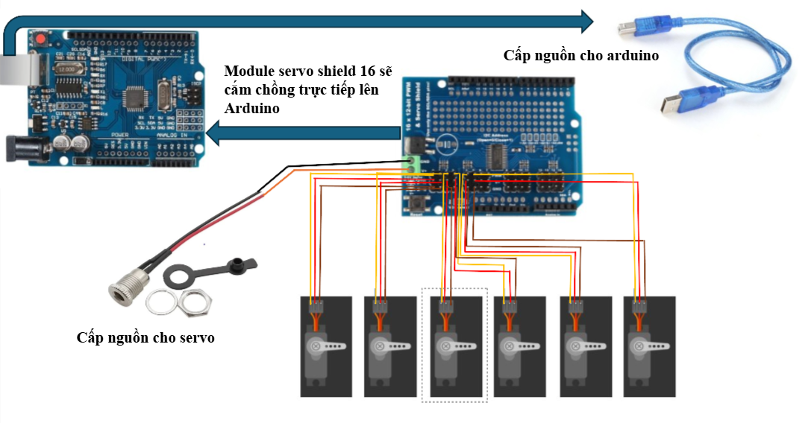
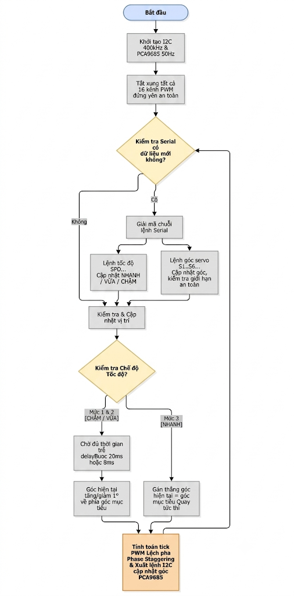

# 🤖 6-DOF Robotic Arm Control System via Web Serial API & 16-Channel Servo Shield (PCA9685)

<p align="center">
  
  <br>
  <b>ĐẠI HỌC QUỐC GIA HÀ NỘI — TRƯỜNG ĐẠI HỌC CÔNG NGHỆ (VNU-UET)</b>
  <br>
  <i>BÁO CÁO ĐỒ ÁN / FINAL PROJECT: THIẾT KẾ VÀ ĐIỀU KHIỂN CÁNH TAY ROBOT 6 BẬC TỰ DO</i>
</p>

<p align="center">
  
  
  
  
  
  
</p>

---

## 📌 Giới Thiệu Tổng Quan (Overview)

Dự án nghiên cứu, thiết kế, chế tạo và điều khiển **Cánh tay Robot 6 bậc tự do (6-DOF Robotic Arm)** tương tác thời gian thực thông qua trình duyệt Web bằng công nghệ **Web Serial API**. Hệ thống sử dụng vi điều khiển **Arduino Uno R3** kết hợp cùng **Module 16-Channel Servo Shield (tích hợp chip PCA9685 12-bit PWM)** dạng cắm chồng (Stackable Shield) để điều khiển độc lập hệ thống 6 động cơ RC Servo (3x MG995 nhông kim loại tải nặng, 1x MG90S, 2x SG90).

Dự án giải quyết triệt để 2 bài toán kỹ thuật thực nghiệm nan giải của cánh tay robot giá rẻ:
1. **Sụt áp đường nguồn khi tải nặng:** Xử lý bằng kỹ thuật **Lệch pha kích xung PWM (Phase Staggering)** trên chip PCA9685 (`onTick = channel * 250`).
2. **Rung lắc cơ khí & giật cục:** Xử lý bằng thuật toán **Nội suy làm mịn góc (Smooth Stepping)** đa nhiệm non-blocking trên Arduino kết hợp với cơ chế **chạy lần lượt (Sequential Execution)** trên Web App.

---

## 📸 Ảnh Giao Diện & Minh Chứng Hoạt Động

<p align="center">
  
  <br>
  <i>Hình: Giao diện Web Application điều khiển cánh tay robot thời gian thực qua Web Serial API</i>
</p>

### 🎬 Minh Chứng Thao Tác Thực Tế:
| Tiếp cận vật thể (Approach) | Gắp vật thể (Grip) | Nâng & Vận chuyển (Lift & Move) |
| :---: | :---: | :---: |
|  |  |  |
| *Cánh tay vươn tới sát vật mẫu* | *Kẹp SG90 siết chặt thân hộp* | *Đế & Vai xoay chuyển vị trí* |

> 📺 **Video minh chứng vận hành đầy đủ:** [Xem trên Google Drive](https://drive.google.com/file/d/18iXaVhXW__igh1NdVsnzToMF-cjBdIls/view?usp=sharing)

---

## ✨ Tính Năng Nổi Bật (Key Features)

- ⚡ **Web Serial API kết nối trực tiếp:** Điều khiển ngay trên trình duyệt Google Chrome hoặc Microsoft Edge qua cáp USB mà không cần cài đặt driver bên thứ ba, không cần chạy Web server cục bộ phức tạp.
- 🛡️ **Thiết kế phần cứng chuẩn Shield (Stackable):** 16-Channel Servo Shield cắm chồng khít lên Arduino Uno, tự khớp đường bus I2C (`A4/SDA`, `A5/SCL`) và nguồn Logic 5V ngầm, loại bỏ 100% dây cắm rời rạc (chống tuột dây, chống nhiễu).
- 🌊 **Thuật toán làm mịn góc (Smooth Motion non-blocking):** Nhích từng 1° theo chu kỳ định thời `millis()`, hỗ trợ 3 mức tốc độ:
  - 🐢 **CHẬM:** Bước 20ms/độ (~50°/s) — cực êm, chống rung, an toàn khi gắp tải nặng.
  - 🚗 **VỪA:** Bước 8ms/độ (~125°/s) — chuyển động đầm tay, lướt mượt.
  - ⚡ **NHANH:** 0ms delay — phản hồi tức thì theo tay kéo slider.
- 🔀 **Kỹ thuật Lệch pha PWM (Phase Staggering):** Đặt thời điểm bật xung của từng kênh cách nhau `onTick = channel * 250`, phân tán đỉnh dòng khởi động, ngăn chặn hiện tượng sụt áp nguồn 6V gây reset chip.
- 🔒 **Quản lý an toàn cơ học:**
  - Khóa cưỡng bức toàn bộ 16 kênh xung khi vừa cấp điện (`pwm.setPWM(ch, 0, 4096)`) — triệt tiêu hiện tượng quăng quật tự phát ban đầu.
  - Khống chế góc Khớp Vai tối đa **140°** (ngăn hiện tượng cộng hưởng *Hunting* do mô-men trọng trường cực đại khi vươn xa).
  - Khống chế góc Tay Kẹp tối đa **123°** (chống kẹt mẻ nhông cơ khí khi kẹp đóng hết cỡ).
- 🔁 **Lập trình bước tự động (Teach & Playback):** Lưu vị trí các bước gắp nhả vật mẫu, tùy chọn chế độ chạy tuần tự (`Sequential`) kèm thời gian chờ thông minh `getServoTransitTime(diff)` để đảm bảo nguồn điện luôn an toàn.

---

## 🏛️ Kiến Trúc Hệ Thống (System Architecture)

### 1. Sơ đồ yêu cầu hệ thống (Input - Process - Output)
<p align="center">
  
</p>

### 2. Kiến trúc tổng thể 3 tầng
<p align="center">
  
</p>

---

## 🔌 Sơ Đồ Đấu Nối & Bảng Phân Bổ Phần Cứng

<p align="center">
  
  <br>
  <i>Hình: Sơ đồ đấu nối phần cứng giữa Arduino Uno R3, 16-Channel Servo Shield và 6 Servo</i>
</p>

### Bảng phân bổ 6 kênh Servo trên Shield PCA9685:
| Kênh trên Shield | Khớp điều khiển | Loại Động cơ | Dải góc an toàn | Mô tả vai trò |
| :---: | :---: | :---: | :---: | :--- |
| **Kênh 5** | Đế xoay (Base) | Servo MG995 | 0° – 180° | Xoay toàn bộ thân cánh tay quanh trục đứng |
| **Kênh 4** | Khớp vai (Shoulder) | Servo MG995 | 0° – 140° | Nâng hạ cánh tay chính (Đảo chiều logic, khóa 140°) |
| **Kênh 3** | Khớp khuỷu (Elbow) | Servo MG995 | 0° – 180° | Gập duỗi cẳng tay |
| **Kênh 2** | Cổ tay xoay (Wrist Rot) | Servo SG90 | 0° – 180° | Xoay tròn định hướng ngàm kẹp |
| **Kênh 1** | Cổ tay gập (Wrist Pitch)| Servo MG90S | 0° – 180° | Chúc ngóc đầu kẹp tiếp cận vật thể |
| **Kênh 0** | Ngàm kẹp (Gripper) | Servo SG90 | 0° – 123° | Đóng/mở hai ngón kẹp giữ vật thể (Khóa 123°) |

> ⚠️ **Lưu ý nguồn điện:**
> - **Nguồn Logic 5V:** Cấp qua cáp USB máy tính nuôi Arduino Uno.
> - **Nguồn Động lực 6V 10A:** Cấp riêng vào cọc ốc vít (Terminal Block V+ và GND) trên mặt Servo Shield.
> - **Chung Mass:** Khi cắm chồng Shield, chân GND tự động được nối chung bo mạch.

---

## 📡 Giao Thức Truyền Thông (Communication Protocol)

### 1. Web Serial / UART (PC ↔ Arduino Uno)
- **Tốc độ Baud:** `9600 bps`, 8 data bits, no parity, 1 stop bit.
- **Định dạng dữ liệu:** Chuỗi ký tự ASCII kết thúc bằng ký tự ngắt dòng `\n`.
- **Cấu trúc gói tin:**
  - **Điều khiển góc:** `S<kênh>:<góc>\n` (Ví dụ: `S1:090\n`, `S4:140\n`, `S0:060\n`).
  - **Thiết lập tốc độ:** `SPD:CHAM\n`, `SPD:TB\n`, `SPD:NHANH\n`.
  - **Dừng khẩn cấp:** `STOP\n`.

### 2. Giao tiếp I2C (Arduino Uno ↔ 16-Channel Servo Shield)
- **Tốc độ bus:** Fast Mode `400 kHz` (`Wire.setClock(400000)`).
- **Địa chỉ I2C:** Mặc định `0x40`.
- **Tần số PWM:** `50 Hz` (chu kỳ xung $T = 20\text{ ms}$).
- **Độ phân giải:** 12-bit (0 – 4095 ticks), ánh xạ xung $500\mu s - 2500\mu s$ tương ứng $102 - 512$ ticks.

---

## 🔄 Lưu Đồ Thuật Toán Điều Khiển Nhúng (Flowchart)

<p align="center">
  
  <br>
  <i>Hình: Lưu đồ thuật toán điều khiển đa nhiệm non-blocking trên Arduino Uno</i>
</p>

---

## 📂 Cấu Trúc Thư Mục Dự Án (Repository Structure)

```text
├── arduino_code/
│   └── servo_control_PCA9685/
│       └── servo_control_PCA9685.ino   # Firmware nạp cho Arduino Uno R3
├── docs/
│   ├── images/                         # Toàn bộ hình ảnh sơ đồ, đấu nối & minh chứng
│   │   ├── uet_logo.png
│   │   ├── system_ipo_diagram.png
│   │   ├── architecture_overview.jpg
│   │   ├── hardware_wiring.png
│   │   ├── firmware_flowchart.png
│   │   ├── web_ui_dashboard.png
│   │   ├── robot_reach.png
│   │   ├── robot_grip.png
│   │   └── robot_lift.png
│   └── Bao_Cao_Canh_Tay_Robot_6DOF.docx # File báo cáo Word chuẩn form VNU-UET
├── index.html                          # Ứng dụng Web App điều khiển nguyên khối (Single-page)
├── Chay_App.bat                        # Script click đúp để mở nhanh Web App
├── .gitignore                          # File cấu hình lọc rác Git
└── README.md                           # Tài liệu thuyết minh dự án GitHub
```

---

## 🚀 Hướng Dẫn Cài Đặt & Vận Hành (Getting Started)

### Bước 1: Nạp Firmware cho Arduino Uno
1. Cài đặt phần mềm [Arduino IDE](https://www.arduino.cc/en/software).
2. Vào **Tools** $\rightarrow$ **Manage Libraries...**, tìm và cài đặt thư viện:
   - `Adafruit PWM Servo Driver Library`
3. Mở file [`arduino_code/servo_control_PCA9685/servo_control_PCA9685.ino`](arduino_code/servo_control_PCA9685/servo_control_PCA9685.ino).
4. Chọn Board: **Arduino Uno**, chọn đúng cổng **COM**.
5. Bấm nút **Upload (Nạp code)**.

### Bước 2: Đấu Nối Phần Cứng
1. Cắm chồng module **16-Channel Servo Shield** lên bo mạch **Arduino Uno R3**.
2. Cắm 6 động cơ Servo vào hàng chân kênh `0` đến `5` theo đúng chiều:
   - Dây vàng/cam (Tín hiệu PWM) $\rightarrow$ Hàng chân ngoài cùng.
   - Dây đỏ ($V+$) $\rightarrow$ Hàng chân giữa.
   - Dây nâu/đen ($GND$) $\rightarrow$ Hàng chân trong cùng.
3. Nối nguồn ngoài DC 6V 10A vào cọc ốc vít xanh trên Shield (đúng cực dương $+$ và âm $-$).
4. Cắm cáp USB nối Arduino Uno với máy tính. Bật nguồn 6V.

### Bước 3: Khởi Động Giao Diện Web Điều Khiển
1. Click đúp vào file [`Chay_App.bat`](Chay_App.bat) (hoặc mở trực tiếp file `index.html` bằng **Google Chrome** hoặc **Microsoft Edge**).
2. Bấm nút **🔌 Cắm Cáp** ở góc phải trên thanh tiêu đề.
3. Chọn cổng COM tương ứng của Arduino và bấm **Connect**. Đèn trạng thái chuyển sang màu xanh **"Đã cắm USB ✓"**.
4. Kéo các thanh slider hoặc bấm các nút tốc độ để bắt đầu điều khiển cánh tay robot!

---

## 🛠️ Xử Lý Lỗi Kỹ Thuật (Troubleshooting & Insights)

### 1. Tại sao Khớp Vai bị rung lắc dữ dội ở góc $145^\circ - 150^\circ$?
- **Nguyên nhân cơ học:** Tại góc này, toàn bộ cánh tay vươn dài ra phía trước, **cánh tay đòn vuông góc với trọng lực đạt giá trị cực đại**, mô-men trọng trường ép xuống vượt quá mô-men giữ danh định của servo MG995. Mạch phản hồi servo liên tục bù trừ vị trí tạo thành hiện tượng **dao động giằng co (Hunting oscillation)**.
- **Khắc phục:** Phần mềm đã khống chế góc an toàn tối đa cho Khớp Vai là **$140^\circ$** (`constrain(goc, 0, 140)`), giúp cánh tay đạt tầm vươn tối đa mà hoàn toàn êm ái, không rung giật.

### 2. Hiện tượng sụt áp khi nhiều Servo khởi động cùng lúc
- **Khắc phục:** 
  1. Nguồn ngoài sử dụng dòng tải lớn **6V 10A**.
  2. Kỹ thuật **Phase Staggering** phân tán thời điểm kích xung PWM cách nhau `channel * 250 ticks`.
  3. Chế độ chạy tự động trên Web sử dụng cơ chế **"➡️ Lần lượt"**, tính toán thời gian `getServoTransitTime()` chờ servo hiện tại quay xong mới cho servo kế tiếp chuyển động.

---

## 👥 Thành Viên Thực Hiện (Team & Credits)

Dự án được thực hiện trong khuôn khổ môn học tại **Trường Đại học Công nghệ — Đại học Quốc gia Hà Nội (VNU-UET)**:

| Họ và tên | Mã Sinh Viên | Vai trò & Đóng góp |
| :--- | :---: | :--- |
| **Hà Trọng Khoa** | **24021133** | Thiết kế cơ khí, lập trình nhúng Arduino, thuật toán làm mịn góc & lệch pha PWM (50%) |
| **Trần Minh Hải** | **24021105** | Thiết kế giao diện Web App, kết nối Web Serial API, lập trình chu kỳ tự động (50%) |

---

## 📄 Bản Quyền (License)

Dự án được phát hành theo giấy phép [MIT License](LICENSE). Mã nguồn mở hoàn toàn dành cho mục đích học tập và nghiên cứu khoa học.
